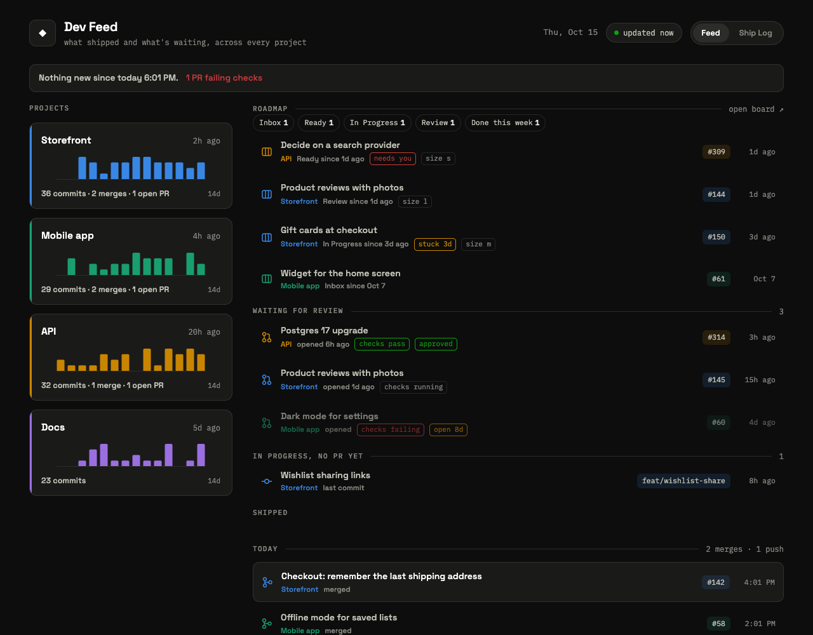
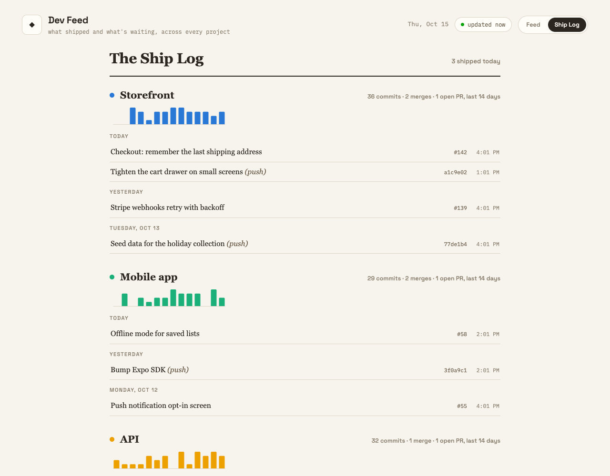

# devfeed

One page for what shipped and what's waiting, across all your GitHub repos.

Built for people with a lot of side projects, or with agents opening PRs for them:
open it in the morning and see what merged, what's waiting for your review, what's
being built on a branch with no PR yet, and what moved on your project board since
you last looked.



- **Since you last looked.** Counts merges, pushes, new PRs, active branches and board
  moves since your last visit, and marks those rows. Tracked per device.
- **Waiting on you.** Open PRs with check and review state, branches with recent
  commits but no PR, and project-board cards with their own labels. Flags PRs open
  7+ days, branches quiet 3+ days, cards stuck in progress for 3+ days, and puts cards
  with your attention label (`needs-human` by default) on top.
- **Repos find themselves.** Every non-archived repo you've pushed to in the last two
  weeks shows up, most recent first, and drops off when it goes quiet. Nothing to list.
- **Next up.** Per repo, which board card to build next so the rest gets easier: what
  it unblocks, which files it shares with other cards, and which cards shouldn't be
  built at the same time. Structure, not feature priority. See below.
- **Ship Log.** A second, calmer view: everything shipped, by project and day.
- **Morning digest.** An optional plain-text email: per active repo, where you left off,
  what's next and what's waiting on you, plus what changed since the last one. See below.



## Try it

**[Live demo](https://rubesworld.github.io/devfeed/)**, with made-up projects. Or run the
demo yourself; no GitHub needed, just Python 3.9+:

```sh
git clone https://github.com/RubesWorld/devfeed && cd devfeed
python3 devfeed.py demo
```

Open http://127.0.0.1:8300.

## Run it on your repos

Requires the [GitHub CLI](https://cli.github.com), logged in with `gh auth login`. On a
server or in a container, set `GH_TOKEN` to a personal access token instead; `gh` picks
it up. The token needs read access to your repos, plus `read:project` if you use a board.

```sh
cp config.example.json config.json   # set "owner" to your GitHub user or org
python3 devfeed.py serve
```

`serve` fetches from GitHub every 5 minutes and serves the page. There are no
dependencies beyond Python's standard library, and nothing is stored: each run
rewrites `public/feed.json` from scratch.

To keep it running in the background, see [`examples/`](examples): a launchd agent
for macOS, a systemd unit for Linux, and a cron line if you'd rather serve
`public/` yourself and only run `devfeed.py collect`.

## Configuration

`config.json`:

| Key | Default | |
|---|---|---|
| `owner` | — | GitHub user or org whose repos to watch. `owners` takes a list. |
| `bind` | `127.0.0.1` | Address to serve on. Use a VPN address (Tailscale, say) to reach it from your phone without exposing it to the internet. |
| `port` | `8300` | |
| `interval_minutes` | `5` | How often `serve` re-fetches. The page flags itself stale after 4 missed runs. |
| `active_days` | `14` | A repo shows up if pushed within this many days. |
| `days` | `30` | How far back the shipped list goes. |
| `spark_days` | `14` | Days in each project's sparkline. |
| `hide` | `[]` | Repos never to show, as `owner/name`. |
| `ignore_branches` | `[]` | Branch names that aren't work in progress. |
| `repos` | `[]` | Per-repo overrides: `display` name, colour `slot` (1–8) and `pin: true` to show it even when quiet. |
| `board` | `null` | A GitHub Projects board, see below. |
| `digest` | — | Email settings for `devfeed.py digest`, see below. |

### Project board

```json
"board": { "owner": "your-user-or-org", "number": 1 }
```

Columns come from the board's own `Status` field, in order. Optional keys: `title`
(defaults to the board's name), `done_column` (`"Done"`), `active_columns` (which
columns count as "in progress" for the stuck flag; defaults to the last two before
Done), `count_only_columns` (`[]`; columns like a Backlog that get a count chip but
no rows), `attention_label` (`"needs-human"`), `hide_labels` (`[]`) and `next_up`
(below). Reading a board needs the
`read:project` scope: `gh auth refresh -s read:project`.

Each card shows the issue's own labels in their GitHub colours, up to three, with the
rest behind a "+N" you can hover. One label is special: the `attention_label` puts the
card at the top, marked "needs you". To keep a noisy label off the cards, list it in
`hide_labels`:

```json
"board": { "owner": "you", "number": 1, "attention_label": "blocked", "hide_labels": ["good first issue"] }
```

Only issues are shown; draft notes and PR cards on the board are skipped.

### Next up

The order of your columns says what matters most. What a board doesn't show is
structure: which card others are waiting on, and which cards will collide because
they change the same files. Next up reads two optional sections from each issue body:

```markdown
## Depends on
- #12: needs the table it adds
- other-repo#3

## Touches
- `src/db/schema.ts`
- `src/app/connect/`
```

Per repo it recommends one card from the candidate columns, ranked by:

1. **Unblocks the most**: cards that depend on it, directly or down a chain.
2. **Shares the most**: a card changing files many others also change is groundwork;
   building it first means the rest build on it once instead of colliding.
3. **Smaller first** on ties (`size:xs` … `size:xl` labels), then further right on the
   board, then oldest.

A card whose dependencies are still open is listed as waiting, never recommended. A
card with your `attention_label` or a `hold_labels` label is never recommended either;
if others wait on it, it's shown as "needs you". Pairs in the candidate or active
columns that change the same files are flagged "don't build together", unless one
already depends on the other.

Without a `## Touches` section, file paths in backticks anywhere in the body are used
instead, and those only count as shared when it's the exact same file.

```json
"board": { "owner": "you", "number": 1,
  "next_up": { "columns": ["Ready"], "hold_labels": ["risk:", "blocked"] } }
```

`next_up` keys, all optional: `columns` (candidate columns; defaults to the one just
before `active_columns`), `hold_labels` (a trailing `:` matches as a prefix, so `risk:`
holds `risk:auth`), `depends_heading` (`"Depends on"`), `touches_heading` (`"Touches"`)
and `size_prefix` (`"size:"`).

## Digest

`python3 devfeed.py digest` collects once and emails a short re-entry note: for each
repo with activity in the last `active_days` (or something waiting on you), where you
left off and everything waiting on you (PRs to fix, merge or review, and cards that need
you), or Next up's card when nothing is waiting, each with a tappable link. Repos with
nothing waiting share one "Also active" line. Then "while you were away": merges, new
PRs and board moves since the last digest. If nothing needs you, the email is one line.

The email is HTML styled like the page's dark Feed view (tables and inline styles, no
images or remote fonts), with a plain-text version for mail apps that prefer it.

```sh
python3 devfeed.py digest --demo      # made-up data, printed; no GitHub, config or email
python3 devfeed.py digest --dry-run   # your real digest, printed, nothing sent
python3 devfeed.py digest             # send it

# Preview the HTML part in a browser (add --html to --demo or --dry-run):
python3 devfeed.py digest --demo --html > /tmp/digest.html && open /tmp/digest.html
```

Add a `digest` block to `config.json`:

```json
"digest": {
  "to": "you@example.com",
  "active_days": 7,
  "smtp": { "host": "smtp.gmail.com", "port": 587, "user": "you@gmail.com" }
}
```

`to` takes a string or a list. `smtp.port` defaults to 587 (STARTTLS); 465 uses SSL.
`smtp.from` defaults to `smtp.user`. Optional `page_url` (your devfeed page, e.g.
`http://your-machine:8300/`) adds an "open devfeed" link to the email. The password is read from the
`DEVFEED_SMTP_PASSWORD` environment variable, or else `smtp.password`. With Gmail, turn
on 2-Step Verification and create an [app password](https://myaccount.google.com/apppasswords);
your normal password won't work.

devfeed doesn't schedule anything. [`examples/`](examples) has a cron line and a launchd
agent that send it at 07:30 every day. The last sent window is kept in
`digest-state.json` next to `config.json` (gitignored, never served), so each digest
covers what happened since the previous one. If GitHub can't be reached, the digest is
built from the last `feed.json` and says how old it is.

The email contains your private repo names, PR titles and card titles, and passes
through your mail provider. Send it only to an inbox you'd trust with that.

## Limits

devfeed is built for one person's or one small team's repos, not a large org:

- Up to 200 repos per owner are considered (most recently pushed first).
- Per repo: the latest 60 commits, 20 recently closed PRs, 20 open PRs and 20 branches.
- The first 500 cards on the board.

Each repo costs about three GitHub API calls per run, so 20 active repos at the default
5-minute interval use about 15% of GitHub's hourly limit.

## Security

devfeed shows whatever your `gh` login can see, private repos included, to anyone
who can reach the page. It binds to `127.0.0.1` by default. If you change `bind`,
put it on a private network, not the open internet.

## License

MIT
